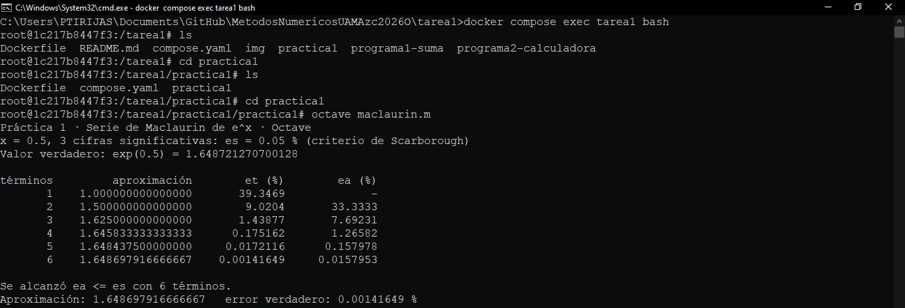
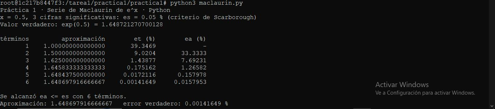
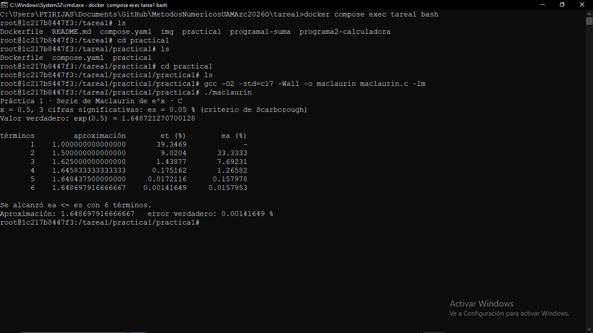

# Práctica 1 · La serie de Maclaurin y el criterio de paro

**UEA 1151039 · Métodos Numéricos en Ingeniería · Trimestre 26-O · UAM Azcapotzalco**
**Profesor:** M. en C. Gabriel Hurtado Avilés

**NOTA: No pude asistir a las clases del 7 y 9 de octubre; por lo tanto trabajé esta práctica sola**

| | |
|---|---|
| Equipo | |
| Integrantes (nombre, matrícula y licenciatura) | Ana Rebeca López Portuguez - 2233074972 - Ing. Mecánica |
| Repositorio de la Tarea 1 de: | Ana Rebeca López Portuguez |
| Fecha: | 12 de octubre del 2026 |

## 1. Octave y Python


Compilación de maclaurin.m


Compilación de maclaurin.py

¿Coinciden con la lámina 25 de la unidad I?
Ambos resultados de los códigos coinciden bien entre sí. Respecto a la diapositiva, solo se parecen en los dos primeros términos; los siguientes dos términos están redondeados a 4 cifras decimales en la tabla de la diapositiva. Pero en los siguientes dos términos, hay un error de redondeo más grande entre la diapositiva y la compilación de los programas.

## 2. Las dos líneas que completamos en `maclaurin.c`

/* COMPLETAR 1 */: Término siguiente consecutivo
```c
termino = termino * X / n;
```

/* COMPLETAR 2 */: Porcentaje de error relativo.
```c
ea = fabs(((aprox - anterior)/aprox) * 100);
```


Compilación de maclaurin.c completo :)

## 3. Más cifras significativas

| Cifras | εs (%) | Términos | Aproximación | Error verdadero (%) |
|---|---|---|---|---|
| 3 | 0.05% | 6 | 1.64869791666667 | 0.00141649 % |
| 6 | 5e-05% | 9 | 1.648721265035962 | 3.43549e-07 % |
| 17 | 5e-16% | 16 | 1.648721270700128 | 2.69354e-14 % |

**Conceptos:**
* εa = Error relativo porcentual *aproximado*.
      compara el valor *aproximado* **actual** con un valor *aproximado* **anterior**.
* εt = Error relativo porcentual *verdadero*.
      compara el valor **verdadero** con el **aproximado**.
* εs = Tolerancia porcentual prefijada.


1. ¿Cuántos términos hacen falta en cada caso?
Si se refiere a términos para alcanzar el límite de cifras significativas, el límite es 17. Entonces tomando como base que 17 cifras es el límite con 16 términos:
- Al de **3 cifras** que tiene 6 términos, le hacen falta 10.
- Al de **6 cifras** con 9 términos, le hacen falta 7.
- El de **17 cifras** es el límite con 16 términos calculados.

2. En cada fila de la tabla, ¿εa es mayor o menor que εt? ¿Por qué conviene detenerse con εa?

En las filas, los valores del error relativo verdadero "εt" son mayores que los del error aproximado "εa". Por eso, de entre 

Cuando el valor del error aproximado es menor a la tolerancia prefijada, el resultado puede considerarse más confiable y exacto. 

Ya que se calcularon el error aproximado y el error verdadero, pueden relacionarse con el número de cifras significativas de la aproximación.

El criterio de Scarborough (εs), indica qué tan confiable es el resultado dependiendo del número de cifras significativas empleadas (n):

εs = (0.5 * 10^2-n)%

Cuando εa < εs. Se dice que se garantiza que el resultado es correcto.

3. Con 17 cifras el programa termina. ¿Cuántas cifras del resultado son correctas en realidad?

¿El resultado de la aproxiamación final? 
El de 17 cifras coincide con el valor verdadero, quedando con un error relativo aproximado de 0%. A partir del término 10, en aproximaciones, se estabiliza mucho más la función, en el decimal 9.  
Entonces se podría decir que las cifras que sí son correctas son: 

```c
1.648721270
```

Además, conforme los cálculos avanzan, el avance se vuelve menos significativo. Crece, crece, crece y después crece un poco menos. Se estabiliza la función. Y por eso conforme más avance hay, se ven cambios menos significativos.


## Uso de inteligencia artificial

Solo unas referencias rápidas de los cuadros de respuesta de Google cuando hice las búsquedas sobre la serie de Maclaurin del exponencial y el criterio de Scarborough. Para poder tener una idea de qué encontraría y qué más podía investigar.

## Referencias
1. Radečić, D. (2026, 4 mayo). Series de Maclaurin: fórmula, desarrollo y ejemplos. Datacamp.
https://www.datacamp.com/es/tutorial/maclaurin-series
2. Métodos numéricos para ingeniería (5.a ed.). (2007). McGRAW-HILL/INTERAMERICANA EDITORES S.A DE C.V.
https://dcb.ingenieria.unam.mx/wp-content/themes/tempera-child/CoordinacionesAcademicas/CA/AN/MaterialDigital/Chapra.pdf
