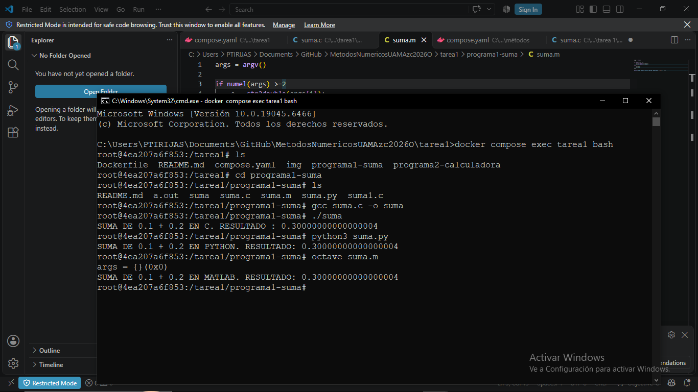

# PROGRAMA1-SUMA
Se compilaron los programas escritos en C, Octave y Python de la suma de 0.1 + 0.2 obtenidos de la línea de comandos y almacenados a 17 dígitos/cifras significativas/64 bits.

Los tres programas tienen sus respectivas anotaciones y referencias porque la verdad estaba un poco perdida en la programación en python y octave; y tenía mucho que no trabajaba en C. 

Los tres tienen el uso de argumentos -> argv. Que se refiere a la cantidad de argumentos que registra cada programa. Los tres pueden recibir dos números (no intenté poner los números) y si no los reciben para la suma, a=0.1 y b=0.2 ya están declarados como variables "double" que según investigué, a diferencia de "float" (que almacena más o menos 5 o 6 dígitos (4 bytes = 32 bits)), double almacena el doble; es decir: 64 bits -> 8 bytes. 

Pero aunque almecene más cifras significativas, el número almacenado sigue siendo finito. Por eso al sumar, no se nos entrega que 0.1---------------- + 0.2---------------- = 0.3.

0.1 y 0.2 se almacenan con 17 cifras, pero aproximadas. No son 0.

Y sí. Por las funciones de almacenamiento dadas como "double" o "str2double", los 3 programas dieron el mismo resultado: 0.30000000000000004

Es una aproximación porque no fue almacenado como un entero. Ahí está la incertidumbre.

Y de ahí viene que no se pueda confiar (?) completamente en los métodos numéricos; es más sencillo trabajar así, pero siempre habrá un grado de error. Aproximaciones.

Muestra de compilación en los 3 archivos/lenguajes:

NOTA: Eliminé los comentarios en suma.m porque al compilar con ellos, marca un error.

 //comparándolo con los otros dos programas (c y python), es como si aquí, diciendo que si argc = 0, es un solo argumento. por eso en el que sigue es = 2, por si en dado caso recibiera los 3 argumentos (el nombre del programa y dos datos: [0, 1, 2] = 3)
 //numel devuelve el total de elementos. e indica cuantos datos fueron introducidos. pero como no se solicita leer ningún dato, se queda en 0 argumentos leídos. a y b se toman de la línea de comandos.
 //str2double doblega la cadena de almacenamiento
 
//BIBLIOGRAFÍA
//1. Passing Arguments to Executable Scripts (GNU Octave (version 11.1.0)). (s. f.). https://docs.octave.org/latest/Passing-Arguments-to-Executable-Scripts.html